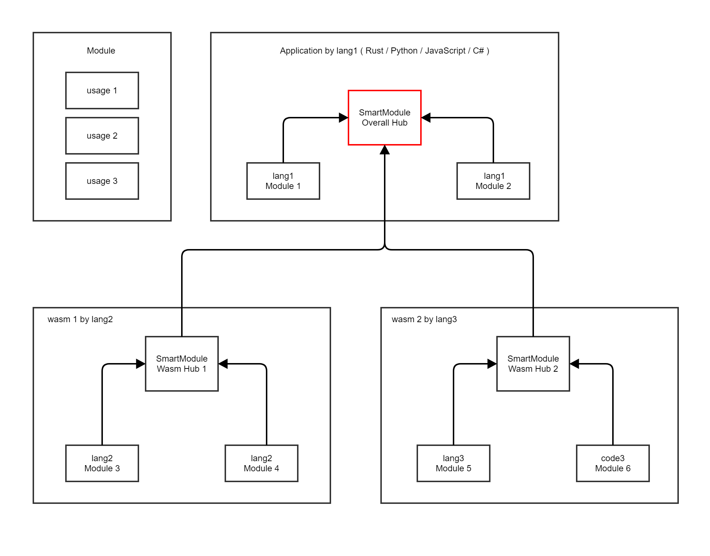

# smloadwasm

A Rust library for loading WebAssembly SmartModules with Wasmtime, registering
their operations with `smcore`, and bridging calls between the host and guests.
It supports both JSON and SmDton payloads.

## Public Rust API

All public functions are available at the crate root, under `smloadwasm`.
The implementation modules are private.

| Module | Function | Description |
| --- | --- | --- |
| `smloadwasm` | `init() -> bool` | Logs library initialization and returns `true`. |
| `smloadwasm` | `compile_wasm(wasm_path: &str, output_path: &str) -> bool` | Reads a Wasm file, precompiles it with Wasmtime, and writes the compiled artifact. Returns `false` if reading, compilation, or writing fails. Use a `.cwasm` output path for subsequent loading. |
| `smloadwasm` | `load_wasm(wasm_path: &str, pagenum: i32) -> bool` | Loads or reuses a guest instance, calls its initialization function, requests `smker.get.all`, and registers the returned operations with `smcore::smh`. Returns `false` if the instance cannot be prepared; instantiation and guest ABI errors may panic. |

`pagenum` is the requested minimum linear-memory size in Wasm pages (64 KiB each).
Memory growth is attempted only when the existing memory is smaller; a failed
growth attempt does not itself make `load_wasm` return `false`. Instances are
cached by path, so later calls for the same path reuse the existing instance.
Registered operations are invoked through `smcore::smh` using the `$usage` field.

Files ending in `.cwasm` are deserialized as precompiled Wasmtime artifacts;
other paths are loaded as Wasm modules. Only load trusted `.cwasm` artifacts
produced by a compatible Wasmtime engine.

## Host Functions Available to Wasm Guests

The tables below use the exact import module and function names registered by
the linker. Signatures describe Wasm arguments and results; host-side caller
context is omitted. `()` means no result.

### Module: `env`

| Function | Signature | Behavior |
| --- | --- | --- |
| `hostdebug` | `(i32, i32) -> ()` | Prints both integer values together with the instance index. |
| `hostgetms` | `() -> i64` | Returns the host's current time in milliseconds. |
| `hostputmemory` | `(ptr: i32, ty: i32) -> ()` | Reads and prints length-prefixed UTF-8 text from guest memory when `ty` is `10`; other types are ignored. |
| `hostcallsm` | `(ptr: i32) -> i32` | Reads a JSON or SmDton request from guest memory, dispatches it through `smcore::smh`, and writes the response into guest memory. Returns the response pointer, or `0` when no response is produced. |
| `emscripten_notify_memory_growth` | `(i32) -> ()` | Compatibility stub: logs a message without updating memory state. |

### Module: `wasi_snapshot_preview1`

`clock_time_get` writes the host's current millisecond time converted to
nanoseconds into the eight bytes at `result_ptr`, in little-endian order, and
returns `0`. The clock ID and requested precision are ignored.

All other functions in this module are compatibility stubs: they log a message
and return zero (or no result). They do not perform the operations implied by
their names or populate output buffers. These imports do not constitute a full
WASI implementation.

| Function | Signature | Implementation |
| --- | --- | --- |
| `clock_time_get` | `(clock_id: i32, precision: i64, result_ptr: i32) -> i32` | Host time, as described above. |
| `proc_exit` | `(i32) -> ()` | Stub; does not terminate the guest. |
| `environ_sizes_get` | `(i32, i32) -> i32` | Stub. |
| `environ_get` | `(i32, i32) -> i32` | Stub. |
| `fd_write` | `(i32, i32, i32, i32) -> i32` | Stub. |
| `fd_close` | `(i32) -> i32` | Stub. |
| `fd_seek` | `(i32, i64, i32, i32) -> i32` | Stub. |
| `sched_yield` | `() -> i32` | Stub. |
| `args_get` | `(i32, i32) -> i32` | Stub. |
| `args_sizes_get` | `(i32, i32) -> i32` | Stub. |
| `random_get` | `(i32, i32) -> i32` | Stub. |
| `poll_oneoff` | `(i32, i32, i32, i32) -> i32` | Stub. |
| `emscripten_resize_heap` | `(i32) -> i32` | Stub. |
| `emscripten_memcpy_js` | `(i32, i32, i32) -> ()` | Stub. |
| `abort` | `() -> ()` | Stub; does not abort execution. |
| `strftime_l` | `(i32, i32, i32, i32, i32) -> i32` | Stub. |
| `emscripten_notify_memory_growth` | `(i32) -> i32` | Stub. |
| `__cxa_throw` | `(i32, i32, i32) -> ()` | Stub. |
| `emscripten_date_now` | `() -> f64` | Stub; returns `0.0`. |
| `__syscall_openat` | `(i32, i32, i32, i32) -> i32` | Stub. |
| `__syscall_fstat64` | `(i32, i32) -> i32` | Stub. |
| `__syscall_stat64` | `(i32, i32) -> i32` | Stub. |
| `__syscall_newfstatat` | `(i32, i32, i32, i32) -> i32` | Stub. |
| `__syscall_lstat64` | `(i32, i32) -> i32` | Stub. |
| `__syscall_fcntl64` | `(i32, i32, i32) -> i32` | Stub. |
| `__syscall_ioctl` | `(i32, i32, i32) -> i32` | Stub. |
| `_tzset_js` | `(i32, i32, i32) -> ()` | Stub. |
| `_localtime_js` | `(i32, i32, i32) -> ()` | Stub. |
| `_munmap_js` | `(i32, i32, i32, i32, i32, i32, i32) -> i32` | Stub. |
| `_mmap_js` | `(i32, i32, i32, i32, i32, i32, i32, i32) -> i32` | Stub. |

## Required Guest Exports

Each guest must export linear memory as `memory` and provide the following
functions. These functions are implemented by the guest and called by the host.

| Module | Function | Signature | Purpose |
| --- | --- | --- | --- |
| Guest | `sminit` | `(load_way: i32) -> i32` | Initializes the guest with `load_way = 0x100`. The returned flags select the payload format: bit `0x100` set selects SmDton; otherwise JSON is used. |
| Guest | `smcall` | `(ptr: i32, mode: i32) -> i32` | Processes a request and returns a response buffer pointer. The host passes `mode = 1`. The guest must handle `smker.get.all` to advertise operations for registration. |
| Guest | `smalloc` | `(size: i32) -> i32` | Allocates a guest buffer for host-written input or a host-call response. |
| Guest | `smdealloc` | `(ptr: i32) -> ()` | Releases a guest response buffer after the host has read it. |
